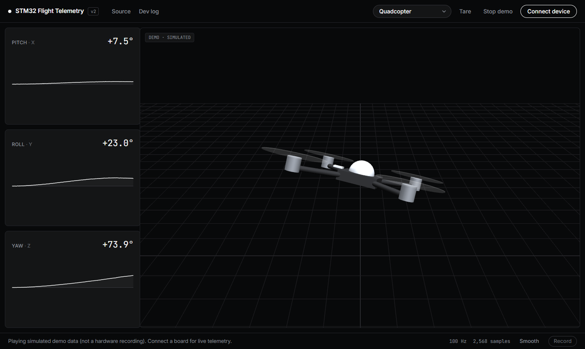
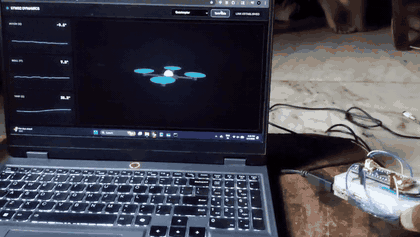
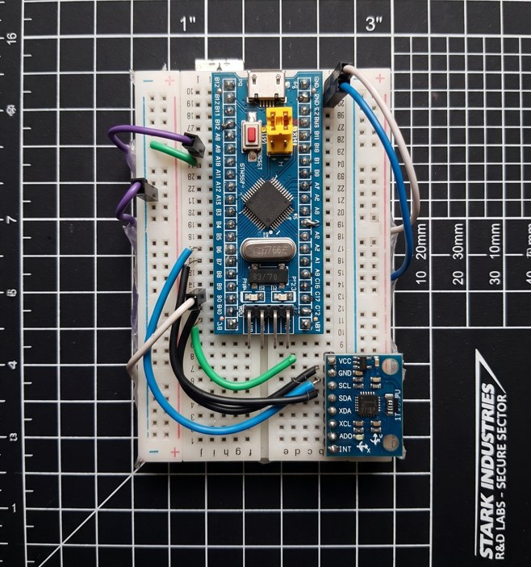
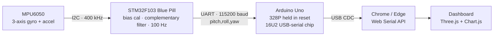
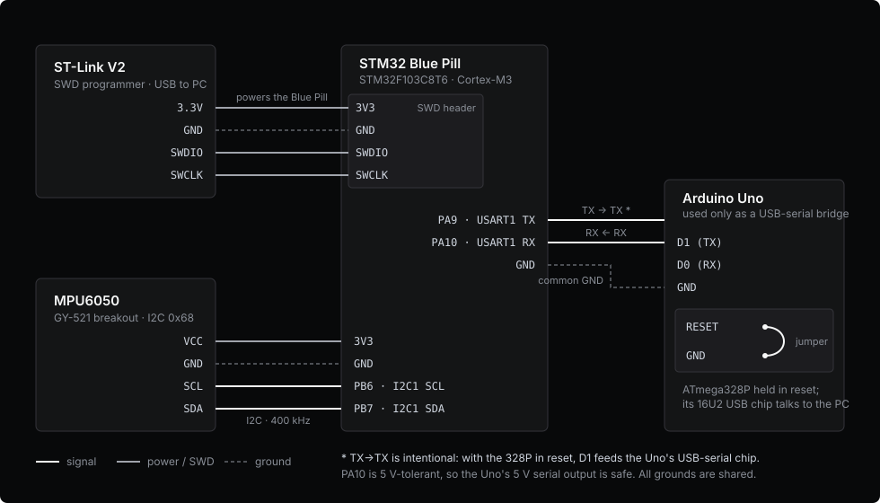
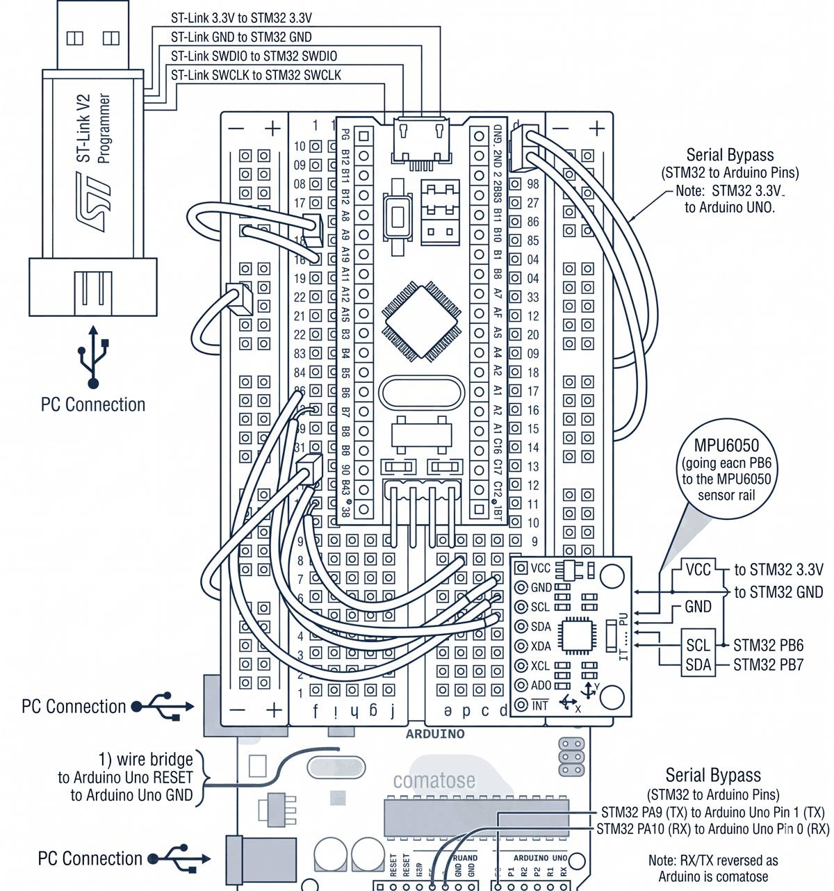

<div align="center">

# STM32 Flight Telemetry

**STM32 Blue Pill + MPU6050 attitude tracker, with a complementary filter on the MCU and a live 3D dashboard in the browser over Web Serial. No backend required.**

[](https://github.com/JeyaVardhan-L/STM32-Flight_Telemetry/actions/workflows/ci.yml)
[](LICENSE)
[](https://jeyavardhan-l.github.io/STM32-Flight_Telemetry/?demo)

[**Open the live dashboard →**](https://jeyavardhan-l.github.io/STM32-Flight_Telemetry/?demo) (plays a demo flight, no hardware needed)



</div>

## The real hardware

<p align="center">
  
  
</p>

Left: the original test run, tilting the board while the dashboard follows ([full video](assets/hardware-test.mp4)). Right: the build (photo retouched).

This started as a one-evening sprint with whatever parts the local shop had. The detours along the way became the best parts of the project. The full story is in the **[development log](Report.md)**.

## What it does

- **Reads the MPU6050 over I2C** (400 kHz) on an STM32F103 "Blue Pill" at a fixed 100 Hz.
- **Fuses gyro and accelerometer on the MCU** with a complementary filter (98% gyro, 2% accelerometer) for pitch and roll.
- **Calibrates the gyro bias at boot** and applies a deadband to yaw, so a resting board doesn't drift.
- **Streams plain CSV** (`pitch,roll,yaw`) over UART at 115200 baud.
- **Uses an Arduino Uno as the USB-serial adapter** by holding its ATmega328P in reset (see [the bridge trick](#the-usb-serial-bridge-trick)).
- **Renders in the browser** with Three.js and Chart.js. The Web Serial API reads the COM port directly, with no Python or Node server.
- **Works without hardware:** a demo mode replays a recording, and a Record button exports real flights as CSV.

## How it fits together



## Hardware

| Part | Notes |
| :--- | :--- |
| STM32F103C8T6 "Blue Pill" | 72 MHz Cortex-M3. Some clones use other chips (e.g. CS32F103), which usually still work with STM32duino. |
| MPU6050 (GY-521 breakout) | 6-axis IMU, I2C address `0x68` |
| ST-Link V2 | SWD programmer; also powers the Blue Pill at 3.3 V |
| Arduino Uno | Used only for its USB-serial chip |
| Breadboard and jumpers | |

### Wiring



| From | To | Purpose |
| :--- | :--- | :--- |
| MPU6050 VCC | Blue Pill 3V3 | Sensor power |
| MPU6050 GND | Blue Pill GND | |
| MPU6050 SCL | **PB6** | I2C1 clock |
| MPU6050 SDA | **PB7** | I2C1 data |
| Blue Pill **PA9** (USART1 TX) | Uno **D1** (TX) | Data to the PC |
| Blue Pill **PA10** (USART1 RX) | Uno **D0** (RX) | |
| Blue Pill GND | Uno GND | Common ground (required) |
| Uno RESET | Uno GND | Holds the 328P in reset |
| ST-Link 3.3V / GND / SWDIO / SWCLK | Blue Pill SWD header | Programming and power |

> **TX→TX is not a mistake.** With the 328P held in reset, the Uno's D1 pin is effectively the *input* of its USB-serial chip (the ATmega16U2), so the STM32's TX goes there. PA10 is 5 V-tolerant, so the Uno's 5 V output can drive it safely.

<details>
<summary>Illustrated breadboard view</summary>



An AI-assisted redraw of the real build, useful for seeing the physical layout. Some pin labels in the artwork are garbled, so use the diagram and table above for the actual connections.
</details>

### The USB-serial bridge trick

There was no USB-to-TTL adapter on the bench, but there was an Arduino Uno. Every Uno has a second microcontroller (the ATmega16U2) whose only job is USB-to-serial. Jumpering **RESET to GND** keeps the main ATmega328P permanently in reset, so its pins float and stop driving the serial lines. The 16U2 is left as a plain USB-serial adapter that anything can use, including an STM32.

## Getting started

### 1. Flash the firmware

**Arduino IDE**

1. Add this URL to *File → Preferences → Additional boards manager URLs*:
   `https://github.com/stm32duino/BoardManagerFiles/raw/main/package_stmicroelectronics_index.json`
2. Install **STM32 MCU based boards** (STMicroelectronics) from the Boards Manager.
3. Install the **Adafruit MPU6050** library. It also pulls in Adafruit Unified Sensor and Adafruit BusIO.
4. Install [STM32CubeProgrammer](https://www.st.com/en/development-tools/stm32cubeprog.html). The IDE calls it to upload over SWD; without it, uploading fails with a missing `STM32_Programmer_CLI` error (Cycle 3 in the dev log).
5. Select *Board: Generic STM32F1 series*, *Board part number: BluePill F103C8*, *Upload method: STM32CubeProgrammer (SWD)*.
6. Open [`firmware/MPU_STMbp_Flight_telemetry/MPU_STMbp_Flight_telemetry.ino`](firmware/MPU_STMbp_Flight_telemetry/MPU_STMbp_Flight_telemetry.ino) and upload.

**Compile from the command line** (this is what CI runs):

```bash
arduino-cli config add board_manager.additional_urls https://github.com/stm32duino/BoardManagerFiles/raw/main/package_stmicroelectronics_index.json
arduino-cli core update-index && arduino-cli core install STMicroelectronics:stm32
arduino-cli lib install "Adafruit MPU6050"
arduino-cli compile --fqbn STMicroelectronics:stm32:GenF1:pnum=BLUEPILL_F103C8 firmware/MPU_STMbp_Flight_telemetry
```

After a reset, **keep the board still for about 2 seconds** while the PC13 LED is on: that's the gyro calibration. A fast-blinking LED means the MPU6050 wasn't found (check the I2C wiring).

### 2. Open the dashboard

Use the **[live site](https://jeyavardhan-l.github.io/STM32-Flight_Telemetry/)** in desktop **Chrome or Edge** (Web Serial isn't available in Firefox or Safari). Click **Connect device** and pick the Uno's COM port.

To run it locally, serve the folder over HTTP and open `http://localhost:8000`:

```bash
python -m http.server 8000
```

Live serial also works when you open `index.html` straight from disk, but demo mode needs HTTP because browsers block `fetch()` on `file://`.

### 3. Dashboard controls

| Control | What it does |
| :--- | :--- |
| Connect device / Disconnect | Opens the serial port at 115200 baud |
| Play demo | Replays [`demo/flight.csv`](demo/flight.csv) |
| Tare | Makes the current orientation the new zero (useful when the desk isn't level) |
| Smooth | Adds browser-side exponential smoothing on top of the MCU filter (adds a little lag) |
| Record | Saves raw samples to a CSV you can replay |
| Model | Quadcopter, satellite, launch vehicle, or a model of the breadboard itself |

### Serial protocol

```text
# Calibrating gyro - keep the board still      <- status lines start with '#'
# Ready - firmware v2 (complementary filter)
12.48,-3.07,0.00                               <- pitch,roll,yaw in degrees, 100 lines/s
```

Anything that prints this format at 115200 baud will drive the dashboard.

## How the math works

**Tilt from gravity.** When the board isn't accelerating, the accelerometer measures only gravity, which gives absolute but noisy angles:

```
pitch_acc = atan2(ay, az)
roll_acc  = atan2(-ax, sqrt(ay² + az²))
```

**Tilt from the gyro.** Integrating the angular rate is smooth and responsive, but small errors pile up into drift:

```
pitch_gyro = pitch + gx · dt
```

**Complementary filter.** Trust the gyro in the short term and let the accelerometer slowly pull the estimate back:

```
pitch = 0.98 · (pitch + gx · dt) + 0.02 · pitch_acc
```

The firmware applies the 0.02 correction along the shortest angular path, so the estimate doesn't jump when the board passes ±180°.

**Yaw.** Gravity says nothing about heading, so yaw is gyro-only. The gyro's constant offset is measured at boot and subtracted, and rates below 0.5 °/s are ignored. Slow drift over minutes is still expected from a 6-axis IMU.

## Engineering lessons

The detours mattered more than the happy path. Each one is written up in the [dev log](Report.md):

- **Programmer ≠ serial port.** The ST-Link flashes the chip over SWD; it doesn't carry `Serial` output. Live data needed a separate UART path, which led to the Uno bridge.
- **A board you already own can stand in for a missing adapter.** Holding the Uno in reset turned it into a USB-serial adapter.
- **Toolchains fail in boring ways.** The first upload failed because STM32CubeProgrammer wasn't installed, not because of anything in the code.
- **Filter where the data is born.** Smoothing in the browser added lag. Moving the fusion onto the MCU removed it.
- **Calibrate before you filter.** Most of the yaw drift came from a constant gyro offset, and averaging it out at boot fixed more than any tuning did.
- **Docs must match the code.** The first published README described a filter the committed sketch didn't have. The [post-ship audit](Report.md#6-cycle-9-the-post-ship-audit-november-2026) explains how that was found and fixed.

## Limitations

- Yaw still drifts slowly. Fixing that needs a magnetometer (e.g. QMC5883L, or an MPU9250 instead of the MPU6050).
- Euler angles have gimbal lock near ±90° pitch, and the filter treats body rates as Euler rates, which is accurate at moderate tilt. Quaternions (Madgwick/Mahony) would remove both limits.
- Accelerometer tilt assumes the board isn't accelerating; sustained linear acceleration biases pitch and roll.
- The bundled demo flight is **simulated** (it says so in the file and on screen). A real hardware recording made with the Record button can replace it.

## Project layout

```text
firmware/MPU_STMbp_Flight_telemetry/   STM32 sketch (v2)
index.html, web/                       dashboard (served by GitHub Pages)
demo/flight.csv                        recording played by demo mode
tests/                                 parser tests (node --test)
assets/                                photos, video, wiring diagram, screenshots
Report.md                              development log and post-ship audit
```

## Versions

- **v2** (current): complementary filter, gyro bias calibration, yaw deadband, fixed-rate loop, error signalling; redesigned dashboard with demo mode, recording, disconnect handling and browser checks; CI.
- **[v1.0-hackathon](https://github.com/JeyaVardhan-L/STM32-Flight_Telemetry/tree/v1.0-hackathon)**: the original one-evening build, kept as it was. Accelerometer-only pitch and roll, raw gyro yaw, single-file dashboard ([screenshot](assets/dashboard-v1.png)).

## Roadmap

- [ ] Replace the simulated demo with a recording from the real board
- [ ] Madgwick/Mahony quaternion filter, with a side-by-side comparison
- [ ] Port the firmware to STM32CubeIDE (HAL) without the Arduino layer
- [ ] Binary packets with a checksum, plus raw sensor channels
- [ ] Magnetometer for absolute heading

## License

[MIT](LICENSE)
